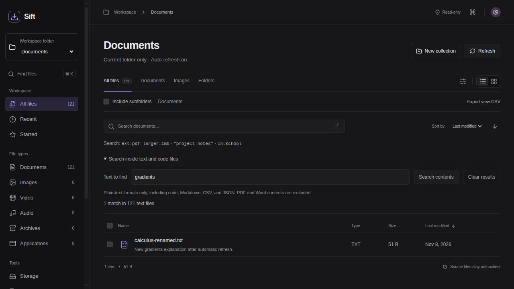

# Sift

Browse a local folder, find files across subfolders, and group related files without moving them.

Sift runs on your computer. A Node server reads a folder you choose; a React interface handles search, previews, collections, tags, and notes. File comparison uses SHA-256. There are no model APIs, accounts, or uploads.



## Run

Requires Node.js 22.6 or newer and npm.

```bash
git clone https://github.com/ebilesh/sift.git
cd sift
npm ci
npm run dev
```

Open **http://127.0.0.1:5173**. The default folder is your Downloads directory. Use **Workspace folder** in the sidebar to switch to another visible folder directly inside your home directory without restarting. Each selectable folder has separate stars, collections, tags, notes, preferences, and a visited-file index. To start with a folder elsewhere on macOS or Linux:

```bash
DOWNLOADS_DIR="/absolute/path/to/folder" npm run dev
```

In PowerShell:

```powershell
$env:DOWNLOADS_DIR = "C:\Users\you\Documents"
npm run dev
```

To run the built app without the development server:

```bash
npm run build
npm start
```

Open **http://127.0.0.1:4318**. Set `DOWNLOADS_DIR` the same way when starting the production app. Keep the server bound to localhost; it reads your files and is intended for one person on one computer.

If the API is unavailable, Sift shows a connection error with a retry button. **Explore sample files** opens an explicitly labeled sample workspace. Sample entries do not have real previews.

## Find files

Turn on **Include subfolders** to search the current directory tree. Results show each file's parent folder. The list and grid display 100 results per page; export and select-all apply to every matching result.

Search supports ordinary words, quoted phrases, and operators. Terms combine with AND:

| Search | Matches |
| --- | --- |
| `"project notes"` | Names containing that phrase |
| `ext:pdf` | PDF files |
| `type:image` | Images |
| `larger:10mb smaller:1gb` | Files between those sizes |
| `in:school ext:ts` | TypeScript files with “school” in their relative path |

**Search inside text and code files** searches plain-text formats and shows matching excerpts. It reads the first 64,000 bytes per file, at most 2,000 candidates and 32 MB total, and reports partial results. It does not extract PDF or Word text. An active content search reruns when a refresh detects folder changes. Each new result set returns to page one. The main search field covers filenames and paths. Advanced filters combine extension, modified date, size, and tags. Searches can be saved and removed. Sorting supports name, modification time, and size in either direction, with a folders-first preference.

## Inspect and organize

- Preview images, PDFs, text, and source code. Text previews show the first 64,000 bytes and never execute code or HTML.
- Play supported audio/video in the browser, including seeking. Codec support depends on your browser. Unsupported files still have metadata and a download-copy link.
- Star files, attach tags and notes, and group selections into collections. Rename or remove collections from **Manage collection**.
- Use **Storage** to inspect category sizes and the largest files in the current scope. Category bars also work with keyboard navigation.
- Use **Duplicates** to compare equal-size candidates with streaming SHA-256 hashes. Review duplicate groups and the bytes in extra copies. Scans can be cancelled, and changed or unreadable files are skipped.
- Export the current results or selected files as CSV. Export and restore workspace metadata as JSON in Settings; restore asks before merging.

Shortcuts: **Ctrl/⌘ K** opens the command palette, **/** focuses search, **Ctrl/⌘ A** selects matching files, and **Escape** closes panels or clears selection.

## Storage and limits

Source files are read-only: Sift has no move, rename, overwrite, or delete endpoint. Downloading a copy does not alter the original. Collections, stars, tags, notes, preferences, and the visited-file index live in browser localStorage. Export backups before clearing browser data. Backups contain relative file identifiers and your notes, not file contents.

Stars and collections resolve against files in previously visited folders. After restoring a backup, browse its folders or enable recursive indexing so those files enter the index. On a complete refresh, Sift matches filesystem device/inode/birth-time identity to preserve metadata across observed renames and moves within a workspace. Ambiguous hard links are not guessed. Missing files remain marked unavailable so their notes can be recovered; a new file at the old path does not inherit the old notes. These identifiers are filesystem-dependent and cannot track copies or moves across filesystems. Metadata is isolated by selectable workspace root. Existing default-folder storage is preserved.

Recursive traversal stops at 20,000 entries or 24 directory levels and reports partial results. Hidden entries and symbolic links are excluded from directory listings. Folder size metadata is excluded from storage totals. Scans read candidate content sequentially and can take time on large folders; Sift checks the current scope every eight seconds while the tab is visible and when the window regains focus. Turn **Automatic refresh** off in Settings to refresh manually. It polls directory metadata rather than installing an OS watcher, and pauses during duplicate scans and open dialogs. It does not maintain a persistent disk index.

The API rejects non-local Host headers and foreign browser origins, confines resolved paths to the configured root, and serves source previews with a sandbox policy and `nosniff`. This is a local utility, not a multi-user service. PDF previews require a browser PDF viewer; fallback links remain available.

## Development

```bash
npm test
npm run build
npm run format:check
```

`workspace.mjs` owns traversal, path checks, and content hashing. `roots.mjs` limits selectable workspace roots; `content-search.mjs` performs bounded text reads. `server.mjs` owns HTTP responses, byte ranges, previews, downloads, and optional built-app serving. `src/model.ts` owns search, sorting, CSV encoding, and backup validation. `src/workspace.ts` owns browser persistence and exports; `src/StorageChart.tsx` renders category bars without a chart dependency. `src/WorkspaceShell.tsx` handles folder selection and storage isolation, `src/reconcile.ts` updates metadata across observed filesystem changes, and `src/ContentSearch.tsx` handles content-search requests and cancellation. Shared controls and previews live in `src/components.tsx` and `src/FilePreview.tsx`. `src/main.tsx` composes the remaining views and interactions.

Tests use temporary folders to check recursive indexing, exact duplicates, hidden-file and symlink exclusion, path confinement, read-only routes, media ranges, downloads, preview limits, search composition, sorting, CSV escaping, and malformed backups. CI runs tests, formatting, and the production build on Node 22.

See [architecture and tradeoffs](docs/architecture.md) for the traversal, hashing, preview, and metadata decisions.
